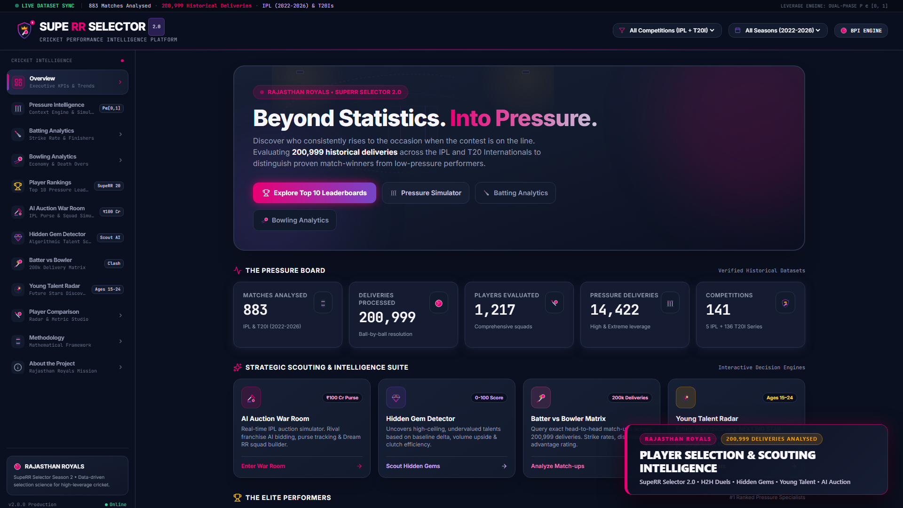

# SupeRR Selector 2.0 — Cricket Performance Intelligence Platform

A data-driven T20 cricket scouting, recruitment, and performance intelligence platform built for **Rajasthan Royals**. SupeRR Selector 2.0 evaluates players across **200,999 historical deliveries from 883 IPL and T20 International matches (2022–2026)** to quantify who performs best when match pressure is highest.



---

## Problem Statement & Objective

In high-stakes Twenty20 cricket, standard aggregate averages (overall Strike Rate, Economy Rate, Batting Average) often conflate low-leverage runs or wickets in decided games with clutch execution under pressure.

**SupeRR Selector 2.0** addresses this challenge with a reproducible analytical pipeline and interactive scouting workspace designed to:

1. Quantify match-context leverage for every delivery using a continuous dual-phase **Pressure Index** ($P \in [0, 1]$).
2. Identify and rank the **Top 10 Batters** and **Top 10 Bowlers** under pressure relative to their own normal-situation baselines.
3. Equip franchise analysts with integrated **Hidden Gem Detection**, **Young Talent Radar (Ages 15–24)**, **Ball-by-Ball Batter vs Bowler Matchups**, and an **AI Auction War Room** for balanced `₹100 Cr` squad building.

---

## Key Features & Modules

### Core Analytics & Pressure Intelligence
- **Overview Dashboard (`src/pages/OverviewPage.tsx`)** — Executive KPI board (`883` matches, `200,999` deliveries processed, `1,217` players evaluated, `14,422` high/extreme pressure deliveries, `141` competitions), pressure severity breakdowns, phase distribution (Powerplay / Middle / Death), season trends (`2022–2026`), and IPL vs T20I comparisons.
- **Pressure Intelligence Engine (`src/pages/PressureIntelligencePage.tsx`)** — Interactive First Innings & Second Innings (chase) match-state simulator adjusting target, score, balls remaining, wickets lost, and required run rate, alongside historical high-pressure case studies.
- **Batting Analytics (`src/pages/BattingAnalyticsPage.tsx`)** — Evaluates `72` qualified batters on Pressure Strike Rate, Strike Rate Delta ($\Delta\text{SR}$), boundary efficiency, team/competition filters, and interactive scatter visualizations.
- **Bowling Analytics (`src/pages/BowlingAnalyticsPage.tsx`)** — Evaluates `84` qualified bowlers on Pressure Economy, Economy Suppression ($\Delta\text{Econ}$), dot-ball percentage, pace vs spin filtering, and minimum-overs thresholds.
- **Player Rankings (`src/pages/PlayerRankingsPage.tsx`)** — Official Top 10 Pressure Batter and Bowler leaderboards (`top20_identities.json`) with podium hierarchy, detailed player modal dossiers, and CSV export (`src/utils/csvExport.ts`).

### Recruitment, Matchup & Strategy Modules
- **AI Auction War Room (`src/pages/AuctionWarRoomPage.tsx`)** — Interactive IPL-style franchise auction simulator across `153` pooled players with a `₹100 Cr` purse tracker, incremental bidding (`+₹50 Lakhs`), simulated rival franchise bids, compliant Dream Squad generation, Overseas/Role cap checks, and squad evaluation audits.
- **Hidden Gem Detector (`src/pages/HiddenGemsPage.tsx`)** — Algorithmic talent scanner scoring `139` profiles on baseline improvement delta, sample volume upside, and clutch consistency, with multi-player shortlisting and detailed scout reports.
- **Batter vs Bowler Matrix (`src/pages/BatterBowlerPage.tsx`)** — Exact ball-by-ball head-to-head lookup engine covering `4,414` matchup records across IPL and T20I deliveries.
- **Young Talent Radar (`src/pages/YoungTalentPage.tsx`)** — Discovery portal for `28` tracked emerging prospects (ages `15–24`) distinguishing verified CSV youth/domestic/IPL statistics from development potential projections, with an Emerging Indian Talent spotlight and Scout Watchlist.
- **Player Comparison Studio (`src/pages/PlayerComparisonStudio.tsx`)** — Side-by-side radar and statistical comparison engine with quantitative verdict explanations.
- **Methodology & Project Information (`src/pages/MethodologyPage.tsx`, `src/pages/AboutPage.tsx`)** — Transparent mathematical formulations (`BPI`, `BPI-Bowl`, Bayesian confidence shrinkage, chase closeness safeguards), preprocessing rules, and printable analytical documentation.

---

## Technology Stack

- **Frontend Framework:** React 18 (`react`, `react-dom`), TypeScript 5.7
- **Build & Tooling:** Vite 6 (`vite`, `@vitejs/plugin-react`), Node.js
- **Styling & UI:** Tailwind CSS 3.4, `clsx`, `tailwind-merge`, `lucide-react`, `canvas-confetti`, custom cricket SVG components
- **Data Visualizations:** Recharts 2.15 (Radar, Scatter, Bar, and Trend charts)
- **Data Processing Pipeline:** Custom streaming Node.js scripts (`scripts/generate_analytics_data.cjs`, `scripts/generate_new_modules_data.cjs`, `scripts/generate_young_talent_data.cjs`, `scripts/run_pipeline.cjs`)

---

## Datasets & Reproducibility

Raw match and delivery files live in `data/raw/`:

| File | Description | Size |
|---|---|---:|
| `data/raw/ball_by_ball.csv` | Historical ball-by-ball records (`200,999` deliveries across `867` matches) | ~39.2 MB |
| `data/raw/playing_eleven.csv` | Match playing XI rosters | ~0.9 MB |
| `data/raw/competition_team_player_mapping.csv` | Competition, franchise, and player mappings | ~0.4 MB |
| `data/raw/matches.csv` | Match metadata, venues, DLS revised overs/targets, and outcomes (`883` matches) | ~0.1 MB |
| `data/raw/competitions.csv` | IPL & T20I competition definitions (`141` competitions) | ~7.4 KB |
| `data/raw/teams.csv` | Franchise and national team registry | ~6.8 KB |

Processed JSON datasets powering the frontend are stored in `src/data/` (`metadata.json`, `batters.json`, `bowlers.json`, `top20_identities.json`, `hidden_gems.json`, `young_talents.json`, `auction_players.json`, `head_to_head_matrix.json`, `pressure_matches.json`, `competitions.json`).

For formal methodology documentation, see [`reports/methodology/supeRR_methodology_report.md`](reports/methodology/supeRR_methodology_report.md).

---

## Installation & Running Locally

### Prerequisites
- **Node.js** (v18+ recommended) and **npm**

### Setup & Run

```bash
# 1. Clone the repository
git clone https://github.com/HarshSingh2007/RR_SuperSelector2026.git
cd RR_SuperSelector2026

# 2. Install frontend dependencies
npm install

# 3. (Optional) Re-run the streaming CSV analytics pipeline from data/raw/
npm run process-data

# 4. Start the local Vite development server (default: http://localhost:5173)
npm run dev
```

### Other Scripts

```bash
# Type-check and create production build in dist/
npm run build

# Preview production build locally
npm run preview
```

---

## Project Structure

```text
RR/
├── data/
│   └── raw/                  # Raw IPL & T20I CSV datasets + Round 1 Problem Statement PDF
├── demo-assets/              # Browser demo automation scripts & dashboard thumbnail
├── reports/
│   └── methodology/          # Technical methodology report
├── scripts/                  # Node.js data ingestion & analytics generation pipeline
├── src/
│   ├── components/           # Shared UI, Header, Sidebar, Modals, Cricket SVG icons
│   ├── data/                 # Generated JSON datasets consumed by the React app
│   ├── pages/                # 12 interactive scouting, analytics & war-room modules
│   ├── types/                # TypeScript domain interfaces
│   ├── utils/                # CSV export and franchise theme helpers
│   ├── App.tsx               # Application shell and module routing
│   └── main.tsx              # React DOM entry point
├── index.html
├── package.json
├── tailwind.config.js
├── tsconfig.json
└── vite.config.ts
```

---

## Screenshots

| View | Preview |
|---|---|
| **Overview Dashboard** |  |
| **Pressure Intelligence Engine** | *\[Placeholder: Add screenshot of Pressure Context Simulator\]* |
| **Player Rankings & Head-to-Head** | *\[Placeholder: Add screenshot of Top 10 Leaderboards / Batter vs Bowler Matrix\]* |
| **AI Auction War Room & Young Talent** | *\[Placeholder: Add screenshot of Live Auction & Squad Builder\]* |
